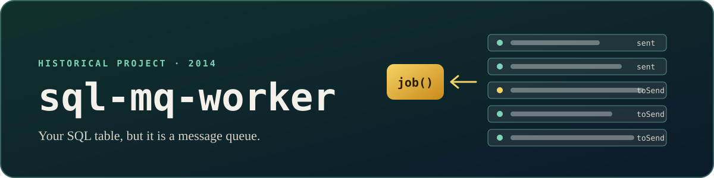
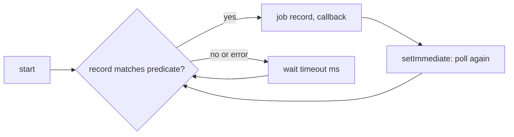

<p align="center"></p>

<p align="center">
  
  
  
  
</p>

> [!NOTE]
> **Historical project (2014).** Written for Node.js 0.10 and Sequelize 1.x, finished at v1.0.3 and not maintained since. It is kept for the record. It has no tests and no license file. See [docs/STATUS.md](docs/STATUS.md) for what is known to work and what is not.

# SQL Message Queue Worker

Treat your SQL table as a message queue that can be worked on by worker processes.

This was inspired by [Resque](https://github.com/resque/resque) for Redis, but I wanted a similarly lightweight system for small, simple SQL-based Node.js applications. No broker, no new service to run: a table you already have, a query that says what "waiting" means, and a function that does the work.

## Features

- Polls a [Sequelize](https://sequelize.org/) model with a query predicate of your choosing.
- Runs your `job(record, callback)` function on the matching record, then moves on to the next one.
- Runs as many worker processes as you like, since the queue is just a table.
- Works with whatever Sequelize talks to (Postgres, MySQL or SQLite, per the original notes).
- One small file: [`index.js`](index.js) is about 45 lines.

## Install

```sh
npm install sql-mq-worker
```

It is on the npm registry (1.0.0 to 1.0.3, checked 2026-11-20). To use this repo directly instead:

```sh
git clone https://github.com/stevenzeiler/sql-mq-worker.git
```

Dependencies, as the original README listed them: Node.js, Sequelize (a 1.x release, as the code uses the old `.find(...).complete(callback)` API), and a Postgres, MySQL or SQLite database.

## Usage

Every SQL-MQ worker performs a job (a function), ultimately calls a callback, and carries on polling for the next database record.

```js
function job(dbRecordInstance, callback) {
  // POST to a service endpoint, for example.
  request.post(SERVICE_URL, dbRecordInstance).complete(callback);
}
```

A worker is given a Sequelize model class, which it queries using the `predicate` option:

```js
var SqlMqWorker = require('sql-mq-worker');

var worker = new SqlMqWorker({
  Class: Payment,
  predicate: { where: { state: "toSend" } },
  job: sendPaymentToServiceJob
});

worker.start();
```

Options:

| Option | Meaning | Default |
|---|---|---|
| `Class` | The Sequelize model to poll | required |
| `predicate` | Options passed to `Class.find(...)`, e.g. `{ where: { state: "toSend" } }` | required |
| `job` | `function (instance, callback)`, called for each record | calls back immediately |
| `timeout` | Milliseconds to wait before polling again when the queue is empty or the query failed | `1000` |

Make sure to use SQL transactions when working jobs and updating the state of the database record object. The worker does not mark a record as done for you: your job should change the record (for example `state: "sent"`) so it stops matching the predicate, otherwise the worker will fetch it again.

## How it works



After a job finishes, the next poll is scheduled with `setImmediate` (so a busy queue drains without a delay and without growing the call stack). When there is nothing to do, or the query fails, the worker sleeps for `timeout` milliseconds.

## Project layout

```
index.js        the Poller class (exported as the module)
package.json    package metadata, v1.0.3
docs/           STATUS.md and the README banner
AGENTS.md       notes for AI agents and contributors
```

## History

- **2014-05-18:** first commit, a poller that pops items off a SQL queue, with a README. Renamed for npm the same day.
- **2014-05-27:** fixed a `this` binding bug.
- **2014-07-22:** removed a recursive call that would have grown the stack.
- **2014-08-01:** switched from `setTimeout` to `setImmediate` after processing a record (pull request #1). Last commit.

It was pulled out of a queue worker in another of Steven's 2014 projects and probably served his gateway work of that year. **(inference)**

---

Project status: [docs/STATUS.md](docs/STATUS.md) · Agent and contributor notes: [AGENTS.md](AGENTS.md)
